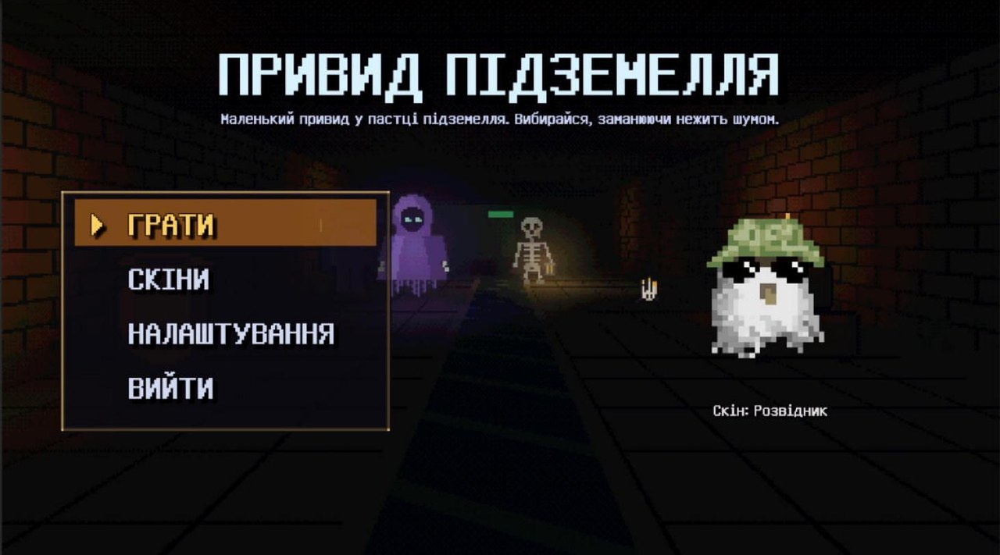
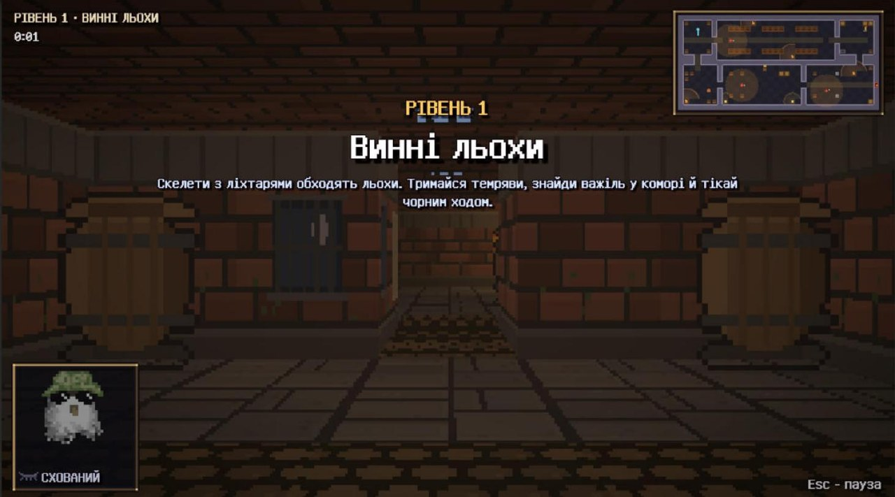
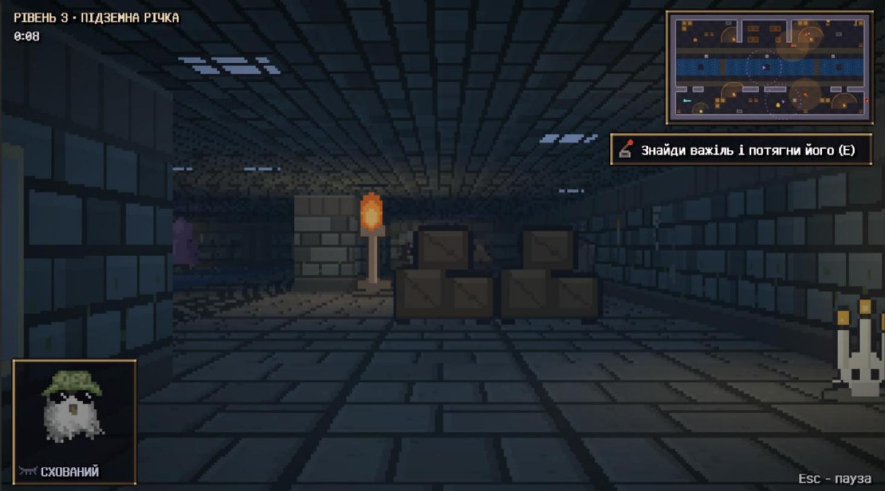
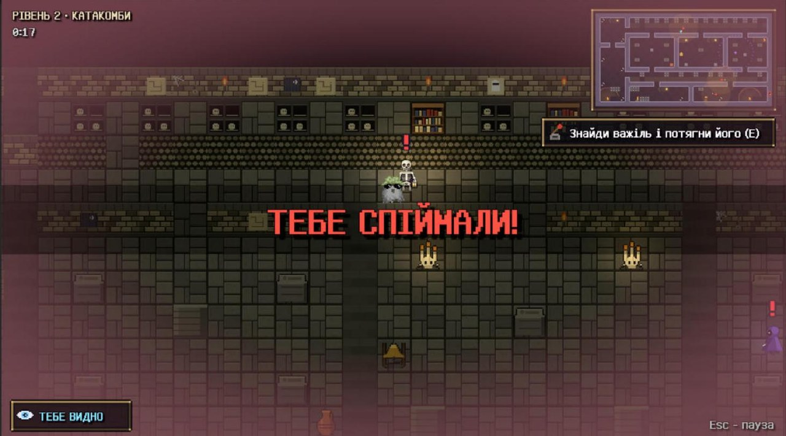
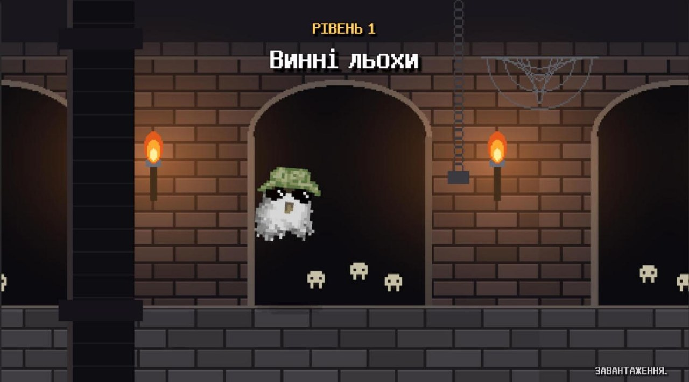
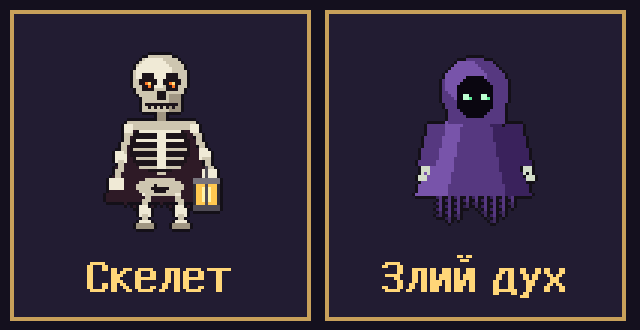
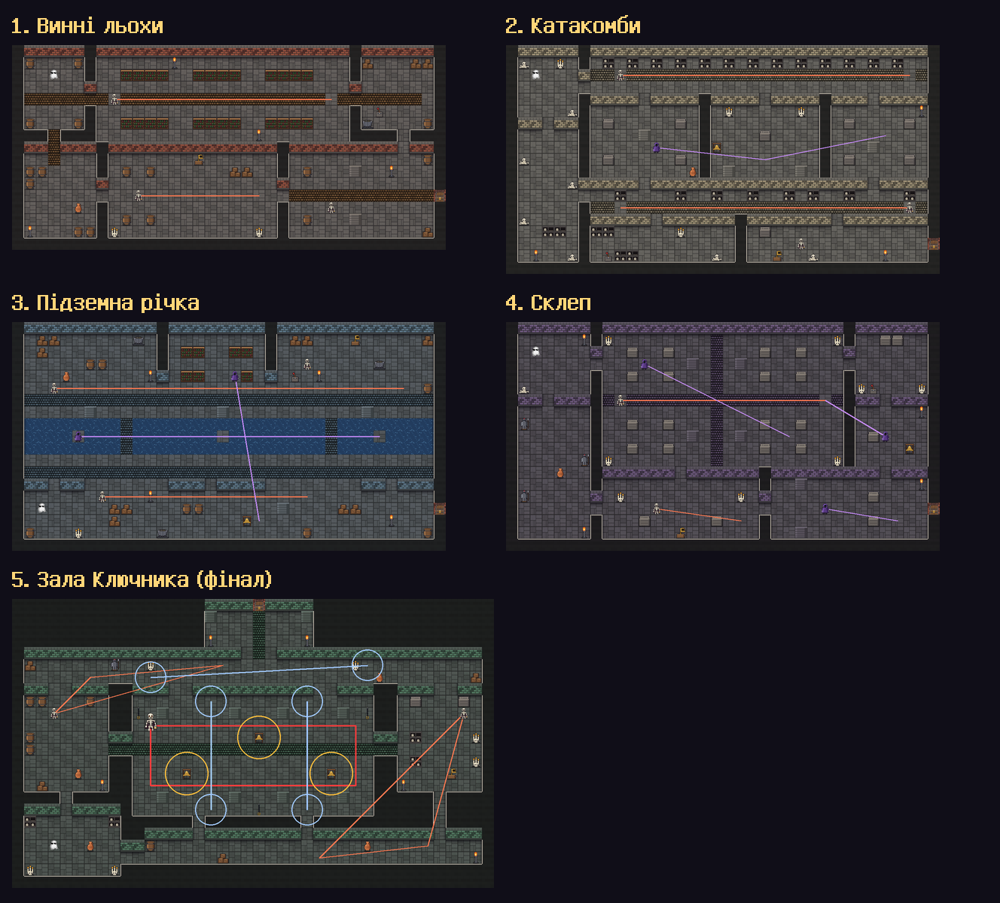
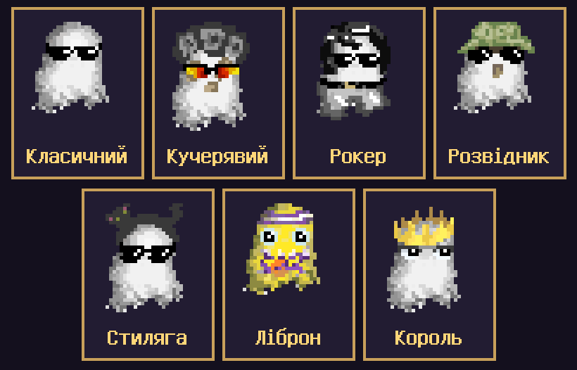
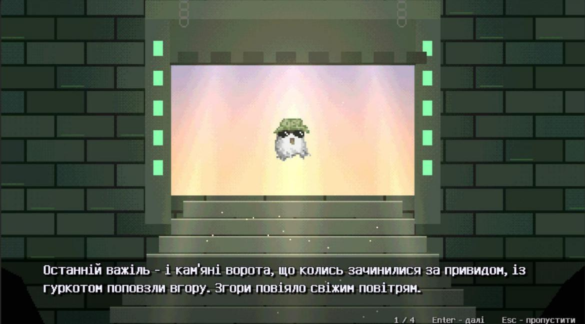
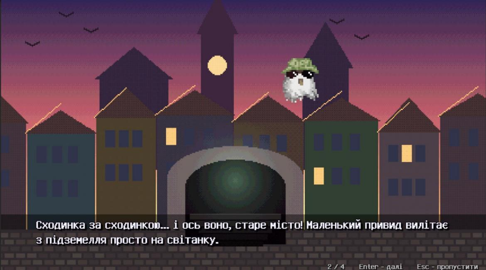

  

<h1 align="center">Привид підземелля</h1>

<h1 align="center">Перший десятигранник: 1 Прикметник: Прозорий</h1>
<h1 align="center">Другий десятигранник: 8 Дієслово: Приманювати</h1>
<h1 align="center">Третій десятигранник: 2 Місце: Підземелля старого міста</h1>
<h1 align="center">Диверсифікатор: 17 Moon & Swoon</h1>

  <b>Піксельний стелс про маленького привида, якого темні сили замкнули глибоко під землею.</b> 
  Ховайся в темряві, заманюй нежить шумом і вибирайся до світанку.

  
  &nbsp;
  

  Windows 10/11 (64-bit) · Unity 6 · 5 рівнів · 3D від першої особи або 2D зверху · українською

---

## Як запустити

1. Завантаж архів **[PryvydPidzemellya-Windows.zip](https://github.com/Markiaaaan/NotAPirateGame/releases/latest/download/PryvydPidzemellya-Windows.zip)**.
2. Розпакуй його будь-куди (правою кнопкою → «Видобути все»).
3. Відкрий папку `PryvydPidzemellya` і запусти `PryvydPidzemellya.exe`.

Інсталювати нічого не треба. Якщо Windows покаже синє вікно SmartScreen, натисни «Докладніше» (More info) → «Однаково запустити» (Run anyway). Назви кнопок можуть трохи відрізнятися. Вікно з'являється, бо гра не має цифрового підпису, як і більшість ігор з геймджемів.

## Про гру

Далеко під землею, серед забутих тунелів і стародавніх руїн, ховається підземелля, про яке не знають навіть найсміливіші шукачі пригод. Одного вечора маленький привид випадково потрапив у пастку темних сил: важкі кам'яні ворота зачинилися за ним, відрізавши шлях назад.

Тепер у кожному коридорі блукають скелети з ліхтарями, а крізь стіни пропливають злі духи. Привид прозорий: у темряві його не видно, але світло його виказує. Щоб вибратися, він заманює нежить шумом, тягне важелі, що відмикають двері, і пролітає повз, поки всі дивляться в інший бік.

  
  
  
  

## Як грати

- **Темрява - твій друг.** Поки ти в тіні, тебе не видно. Смолоскипи, свічки й ліхтарі скелетів тебе проявляють. На мінікарті світло позначене жовтими колами.
- **Шуми, щоб відволікти.** Підлети до предмета й натисни **E**: нежить піде подивитися, що сталося, а ти прослизнеш повз.
- **Двері замкнені.** На кожному рівні вихід відчиняє важіль (на мінікарті - жовта точка, що блимає). Але він гуркоче на все підземелля, тож вся нежить біжить до нього. Потягнув - тікай іншим ходом!
- **Спіймали - не біда.** Рівень почнеться спочатку, а в кінці гри покажуть, скільки разів тебе зловили.

| Предмет | Що робить |
|---|---|
| Глечик | Розбивається з гуркотом, один раз. Крізь уламки можна пролітати |
| Патефон | Грає старий вальс 5 секунд |
| Дзвін | Найгучніший, чути через півпідземелля |
| Лицарські обладунки | Від поштовху з гуркотом з'їжджають убік |
| Важіль | Відмикає вихід і скликає всю нежить |
| Ланцюг вантажу | Скидає кам'яний вантаж на позначку під дзвоном. Тільки так можна здолати Ключника |

## Вороги

| | Як працює | Як обійти |
|---|---|---|
| **Скелет** | Ходить маршрутом із ліхтарем. Поруч ліхтар освітлює тебе з усіх боків, а далі скелет бачить лише освітленого привида. Через воду не ходить, тільки мостами | Тримайся в темряві, обходь ліхтар. Заманюй шумом подалі від проходу |
| **Злий дух** | Нічого не бачить, але відчуває **рух** навіть крізь стіни. Пролітає крізь стіни й над водою. Коли він поруч, ти чуєш шепіт, а на екрані з'являється «ДУХ ПОРУЧ» / «ЗАВМРИ!» | Завмри й не рухайся, поки він не відлетить. Повертати камеру можна |
| **Ключник** | Велетенський скелет із ключем на поясі, бос фіналу. Кожен дзвін у його залі кличе Ключника до себе | Удар у дзвін під кам'яним вантажем, відлети й тягни ланцюг, коли Ключник прийде. Три влучання - і ключ твій |

Над головою ворога **?** означає, що він щось почув, а **!** - що побачив тебе і женеться. Тоді тікай у темряву: загубивши тебе, ворог трохи пошукає й повернеться на маршрут.

## Рівні

1. **Винні льохи** - винний зал, комора й таверна. Навчальний рівень із підказками.
2. **Катакомби** - галереї з нішами для черепів і поховальні камери. Тут з'являється перший злий дух.
3. **Підземна річка** - два береги й два мости. Скелети ходять лише мостами, духи пролітають над водою.
4. **Склеп** - великий зал із саркофагами, каплиці й гробниця хазяїна підземелля.
5. **Зала Ключника** - фінал. Ключ від виходу носить Ключник: скинь на нього три кам'яні вантажі. Крізь ґрати в стелі повзуть плями місячного світла, і в них тебе видно.

## Скіни

Привида можна вдягнути в меню **Скіни**: клацни на скін, і він одразу застосується. Вибраний скін видно в грі, на екрані переходу між рівнями й у фіналі.

Коли привида ловлять, Ліброн губить пов'язку, а Король корону.

## Керування

| Клавіша | Дія |
|---|---|
| **W A S D** | Летіти |
| **Миша** або **← →** | Роззиратися (у 3D) |
| **E** | Використати предмет чи важіль |
| **R** | Почати рівень заново |
| **Esc** | Пауза (гучність, чутливість миші, вихід у меню). У кат-сцені - пропустити |
| **Enter** | Далі в кат-сцені, сховати підказку |

У **Налаштуваннях** можна вибрати вигляд (3D від першої особи або 2D зверху), складність (Легко / Нормально / Важко), гучність музики й звуків, чутливість миші та повноекранний режим. Усе зберігається між запусками.

  
  

## Для розробників

- Unity **6000.6.6f1** (URP 2D, Input System).
- Відкрий проєкт, дочекайся компіляції й натисни **Tools → Ghost → Зібрати всю гру**, потім відкрий сцену `MainMenu` і тисни **Play**.
- **Tools → Ghost → Зібрати Windows-версію (.exe)** збирає гру в `Build/PryvydPidzemellya/` і пакує архів `Build/PryvydPidzemellya-Windows.zip`. Саме його треба завантажувати в реліз.

## Команда

Гру зробила команда ОПІ "BooBooBooShahur" з шести людей на Всеукраїнський ігровий хакатон 7.0 (Global game jam 2026).
| | Хто | Що робив(ла) |
|---|---|---|
| 🎃 | **Богдан Бовшик** | Капітан команди |
| 💻 | **Маркіан Курах** | Програмування, геймдизайн, рівні, 2D/3D-вигляд, збірка гри й README |
| 👻 | **Анастасія Дуброва** | Спрайти привида і скіни |
| 📜 | **Ганна Кулікова** | Сюжет і тексти кат-сцен, ілюстрації фіналу, правки рівнів і меню |
| 💀 | **Дмитро Миколаєвич** | Фінальний рівень: бос Ключник, пастка з вантажем, кат-сцена перед фіналом |
| 🕯️ | **Андрій Макаренко** | Учасник команди |

Піксельний шрифт зроблено на основі [GNU Unifont](https://unifoundry.com/unifont/) (SIL Open Font License 1.1).
